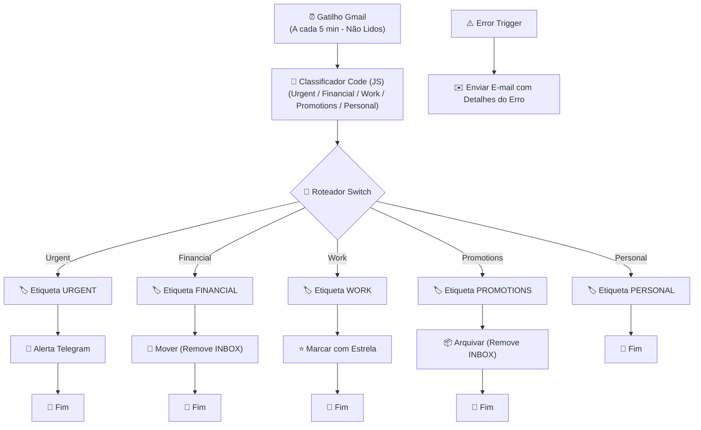

# 📬 Organizador Automático de E-mails Gmail com n8n

[](https://n8n.io)
[](https://developers.google.com/gmail/api)
[](https://core.telegram.org/bots)
[](https://www.docker.com/)
[](LICENSE)

Fluxo automatizado e inteligente para o **n8n** que monitora sua Caixa de Entrada do Gmail em tempo real (polling a cada 5 min), classifica cada mensagem por relevância com regras determinísticas em JavaScript e executa ações automáticas de organização (etiquetar, mover, arquivar, favoritar e alertar via Telegram ou e-mail de backup).

---

## 🚀 Principais Funcionalidades

- **⏱️ Monitoramento Contínuo:** Gatilho nativo do Gmail buscando e-mails não lidos a cada 5 minutos.
- **🧠 Classificação Inteligente em Código:** Nó de código JavaScript ultrarrápido com normalização de acentos (`itaú` = `itau`, `promoção` = `promocao`).
- **🎯 5 Categorias Pré-configuradas:**
  - `Urgent`: Termos de alta prioridade (assunto).
  - `Financial`: Bancos, faturas, boletos e pagamentos (remetente).
  - `Work`: Domínios corporativos e e-mails de trabalho (remetente).
  - `Promotions`: Promoções, cupons e ofertas (assunto).
  - `Personal`: Fallback para tudo o que não encaixar nas regras acima.
- **⚡ Ações Automáticas por Categoria:**
  - **Urgente:** Aplica etiqueta `URGENT` e envia notificação formatada para o seu **Telegram** (com fallback para e-mail).
  - **Financeiro:** Aplica etiqueta `FINANCIAL` e move da Inbox para a pasta financeira.
  - **Trabalho:** Aplica etiqueta `WORK` e marca com estrela (`STARRED`).
  - **Promoções:** Aplica etiqueta `PROMOTIONS` e arquiva (remove da Inbox).
  - **Pessoal:** Aplica etiqueta `PERSONAL`.
- **🛡️ Tratamento de Falhas (Error Trigger):** Em caso de erro na execução, envia automaticamente um e-mail de alerta com os dados do erro, nó responsável e link da execução.
- **🐳 Docker Ready:** Inclui `docker-compose.yml` para rodar o n8n localmente com um único comando.

---

## 📐 Arquitetura do Fluxo



---

## 📊 Regras de Classificação

| Ordem | Categoria | Critério Analisado | Termos de Exemplo | Ação Executada |
| :---: | :--- | :--- | :--- | :--- |
| **1** | **Urgent** | **Assunto** | `urgent`, `urgente`, `importante`, `asap`, `crítico`, `emergência`, `prioridade` | Etiqueta `URGENT` + Notificação no **Telegram** |
| **2** | **Financial** | **Remetente** | `bank`, `nubank`, `itau`, `bradesco`, `santander`, `invoice`, `boleto`, `fatura`, `pix` | Etiqueta `FINANCIAL` + Mover da Inbox |
| **3** | **Work** | **Remetente** | `@company`, `@work`, `@empresa.com`, `@empresa.com.br` | Etiqueta `WORK` + Marcar com estrela ⭐ |
| **4** | **Promotions** | **Assunto** | `promoção`, `oferta`, `desconto`, `cupom`, `black friday`, `sale` | Etiqueta `PROMOTIONS` + Arquivar |
| **5** | **Personal** | *Fallback* | Qualquer e-mail que não coincidir com as regras anteriores | Etiqueta `PERSONAL` |

---

## 📁 Estrutura do Repositório

```text
n8n-workflow-organizador-gmail/
├── .github/
│   └── workflows/
│       └── validate-json.yml        # CI para validação de sintaxe JSON do fluxo
├── docs/
│   └── setup-gmail-oauth.md         # Tutorial passo a passo para credenciais Google OAuth2
├── workflows/
│   └── n8n-workflow-organizador-gmail.json  # Arquivo exportado do fluxo pronto para importação
├── .env.example                     # Modelo de variáveis de ambiente
├── .gitignore                       # Arquivos ignorados pelo Git
├── docker-compose.yml               # Ambiente n8n local pronto para subir
├── LICENSE                          # Licença MIT
└── README.md                        # Documentação completa
```

---

## 🛠️ Pré-requisitos

1. **Instância do n8n** (Cloud, Self-Hosted ou via Docker).
2. **Conta no Gmail**:
   - Crie as seguintes etiquetas personalizadas no Gmail antes de ativar o fluxo:
     - `URGENT`
     - `FINANCIAL`
     - `WORK`
     - `PROMOTIONS`
     - `PERSONAL`
3. **Credencial Gmail OAuth2**:
   - Consulte o guia completo em [docs/setup-gmail-oauth.md](docs/setup-gmail-oauth.md).
4. **(Opcional) Bot no Telegram**:
   - Crie um bot com o [@BotFather](https://t.me/BotFather) para receber notificações urgentes.

---

## 📥 Como Importar o Fluxo no n8n

### Opção 1: Via Importação de Arquivo
1. Baixe o arquivo [`workflows/n8n-workflow-organizador-gmail.json`](workflows/n8n-workflow-organizador-gmail.json).
2. No seu n8n, acesse o menu **Workflows**.
3. Clique nos três pontinhos `...` no canto superior direito e selecione **Import from File**.
4. Selecione o arquivo baixado.

### Opção 2: Copiar e Colar
1. Abra [`workflows/n8n-workflow-organizador-gmail.json`](workflows/n8n-workflow-organizador-gmail.json) e copie todo o conteúdo.
2. No n8n, crie um novo fluxo em branco.
3. Clique na tela do fluxo e pressione `Ctrl + V` (ou `Cmd + V` no macOS).

---

## ⚙️ Configuração Pós-Importação

Após importar o fluxo no seu n8n, ajuste os seguintes pontos:

1. **Credenciais do Gmail:**
   - Selecione sua credencial OAuth2 do Gmail em cada um dos nós do Gmail.
2. **IDs das Etiquetas:**
   - Nos nós que aplicam etiquetas, abra o nó e selecione a etiqueta correspondente criada na sua conta.
3. **Notificação no Telegram (Ramo Urgent):**
   - No nó **Urgente: Notificar no Telegram**, selecione sua credencial do Telegram e configure seu `chatId` (ou configure a variável de ambiente `TELEGRAM_CHAT_ID`).
   - *Alternativa:* Se não quiser usar o Telegram, ative o nó desativado **Urgente: E-mail de Backup (Alternativa)**.
4. **Variáveis de Ambiente (Opcional):**
   - `ALERT_EMAIL`: E-mail de destino para alertas de falhas do fluxo.
   - `TELEGRAM_CHAT_ID`: ID do chat de destino para alertas urgentes.

---

## 🐳 Executando Localmente com Docker

Caso deseje testar ou rodar o n8n em sua máquina:

1. Clone este repositório:
   ```bash
   git clone https://github.com/Jerfson/n8n-workflow-organizador-gmail-.git
   cd n8n-workflow-organizador-gmail-
   ```
2. Crie seu arquivo `.env`:
   ```bash
   cp .env.example .env
   ```
3. Inicie os contêineres:
   ```bash
   docker compose up -d
   ```
4. Acesse o n8n no navegador em: `http://localhost:5678`

---

## 🧩 Personalização das Regras

Para ajustar as palavras-chave ou incluir o domínio da sua empresa:
1. Abra o nó **Classificar E-mail por Categoria** (Code).
2. Edite os arrays no topo do script:
   ```javascript
   const PALAVRAS_URGENTE = ['urgent', 'urgente', 'importante', 'asap', ...];
   const PALAVRAS_FINANCEIRO = ['bank', 'banco', 'nubank', 'itau', 'boleto', ...];
   const DOMINIOS_CORPORATIVOS = ['@minhaempresa.com.br', '@cliente.com', ...];
   const PALAVRAS_PROMOCAO = ['promoção', 'oferta', 'cupom', 'desconto', ...];
   ```
3. Salve o fluxo.

---

## 📄 Licença

Este projeto é distribuído sob a licença [MIT](LICENSE).
